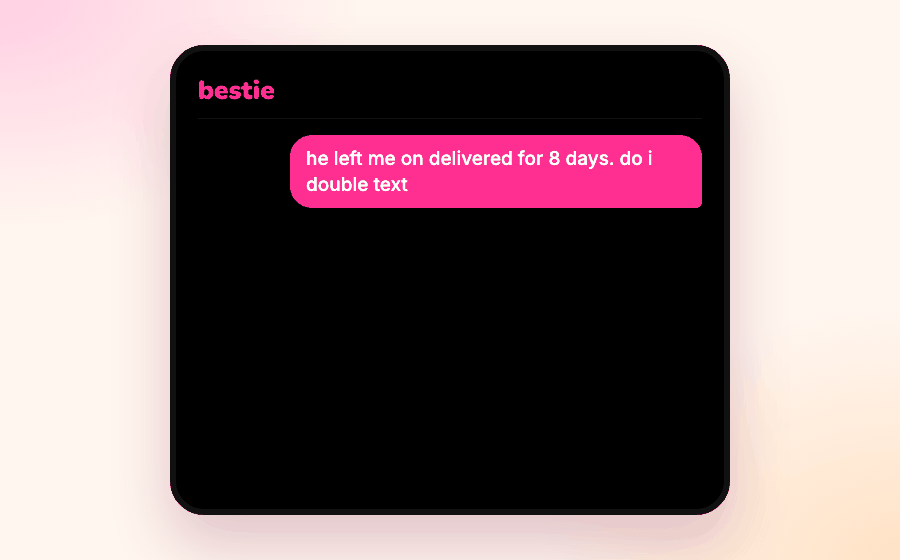

  
  
  

<b>the ai best friend who actually remembers.</b> text her about the situationship, the group chat, your boss. she knows who's who, follows up on what matters, and tells you the truth.

  

### what she does

- 🧠 **remembers your whole life.** the people, the drama, how it's going. you never explain the story twice
- 📱 **texts you first.** "wait how did the interview go"
- 📸 **reads the screenshot** and tells you what he actually meant
- ✍️ **writes the text** you're too scared to send
- 💬 **tells you the truth,** even when it's not what you wanted to hear

  
  
  

### built to be good for you

- **honest.** bestie is an ai, and she'll always tell you that
- **not a replacement.** she hypes you up to text your real friends, and she's happiest when you have plans
- **there for the hard nights.** if things get heavy, she shares real crisis resources for where you are
- **adults only.** bestie is 18+

### work with us

we pay creators to post about bestie. **[join our creator program →](https://askbestie.co/creators)**

[askbestie.co](https://askbestie.co) · [privacy](https://askbestie.co/privacy) · [terms](https://askbestie.co/terms)
